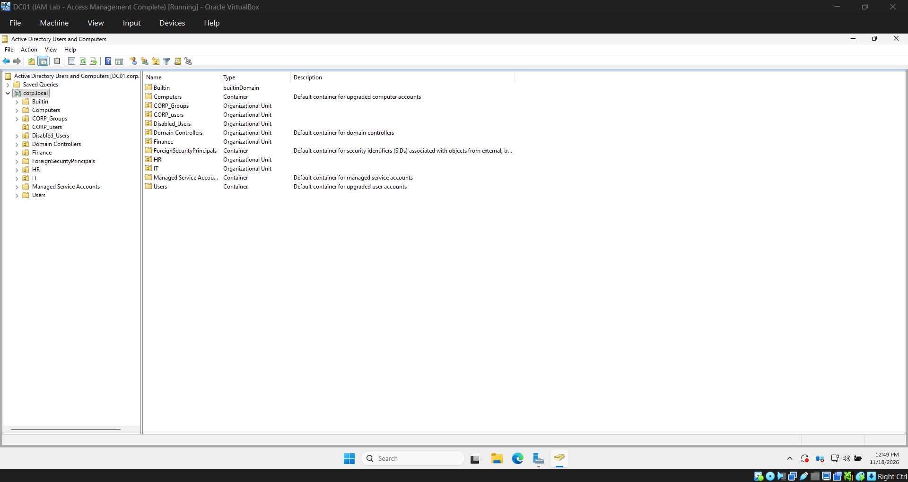
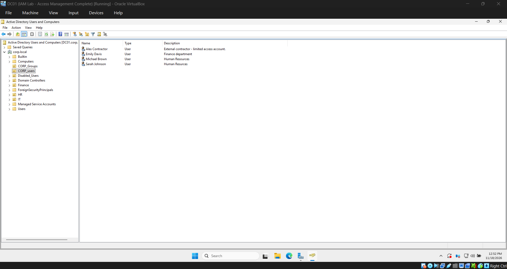
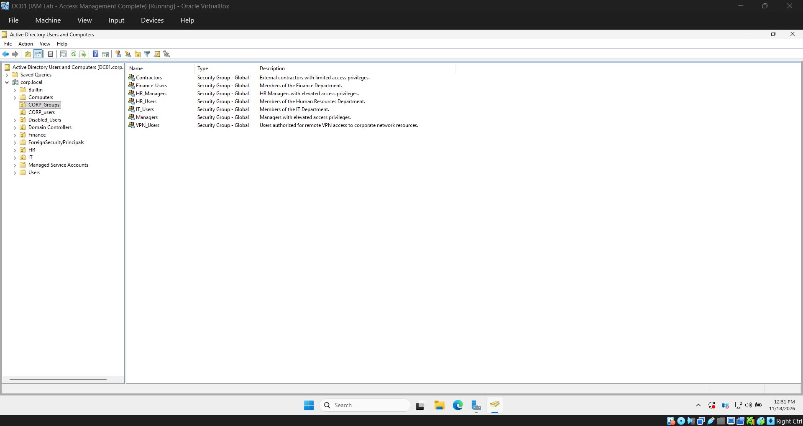
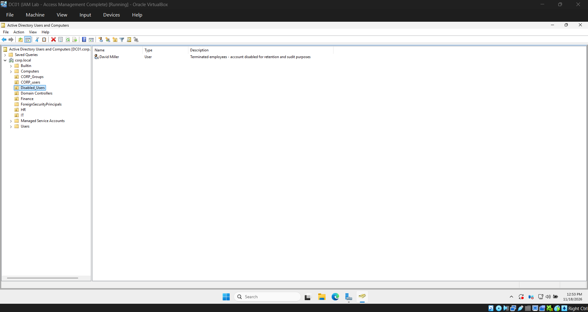

# Active Directory Lab

## Overview

This project demonstrates the deployment and administration of a Windows Active Directory environment designed to simulate real-world identity and access management (IAM) operations.

The lab focuses on common administrative tasks including user provisioning, group-based access control, organizational unit (OU) design, and user lifecycle management.

## Environment

| Component | Purpose |
|------------|----------|
| Windows Server | Domain Controller |
| Active Directory Domain Services (AD DS) | Identity Management |
| Active Directory Users and Computers (ADUC) | Administration Interface |
| corp.local | Lab Domain |

## Skills Demonstrated

- Active Directory Administration
- User Provisioning
- User Deprovisioning
- Organizational Unit (OU) Design
- Security Group Management
- Role-Based Access Control (RBAC)
- Least Privilege Principles
- Identity Lifecycle Management
- Windows Server Administration

## Lab Objectives

The goal of this lab was to gain hands-on experience with enterprise identity administration by creating a structured Active Directory environment that reflects common organizational practices.

Key objectives included:

- Creating Organizational Units (OUs)
- Creating and managing user accounts
- Building security groups
- Assigning group memberships
- Implementing role-based access control
- Managing employee offboarding workflows

## Organizational Structure

The domain was organized into departmental and administrative Organizational Units to support scalability and delegation.

Departments included:

- Finance
- Human Resources (HR)
- Information Technology (IT)
- Disabled Users
- Corporate Users
- Corporate Groups

### Organizational Unit Structure

## User Management

Multiple user accounts were created to represent employees and contractors within various departments.

Sample accounts included:

- Alex Contractor
- Emily Davis
- Michael Brown
- Sarah Johnson

User descriptions were used to identify departmental responsibilities and account purposes.

### User Management

## Security Groups

Security groups were created to support role-based access control and least-privilege access assignments.

Groups included:

- Contractors
- Finance_Users
- HR_Users
- HR_Managers
- IT_Users
- Managers
- VPN_Users

### Security Groups

## Role-Based Access Control (RBAC)

Access was assigned through group membership rather than directly to user accounts.

This approach supports:

- Easier administration
- Least privilege
- Consistent access management
- Reduced administrative overhead

Example: Sarah Johnson was assigned to multiple groups based on business responsibilities.

### Group Membership Management

.png)

## User Offboarding

To simulate employee termination procedures, a disabled user account was moved into a dedicated Disabled_Users Organizational Unit.

This demonstrates common IAM lifecycle management practices including:

- Account disablement
- Account retention
- Audit preservation
- Separation from active users

### User Offboarding

## Lessons Learned

This project provided practical experience with:

- Active Directory administration
- Enterprise identity management
- Security group implementation
- Access control management
- User lifecycle processes
- Organizational design within Active Directory

## Future Enhancements

- Group Policy Objects (GPOs)
- Password Policies
- Account Lockout Policies
- Shared Folder Permissions
- LDAP Administration
- Hybrid Identity with Microsoft Entra ID
- Privileged Access Management (PAM)

## Career Relevance

The skills demonstrated in this lab are directly applicable to:

- IAM Analyst
- Access Management Analyst
- Security Administrator
- Systems Administrator
- Help Desk Technician
- Cybersecurity Analyst
